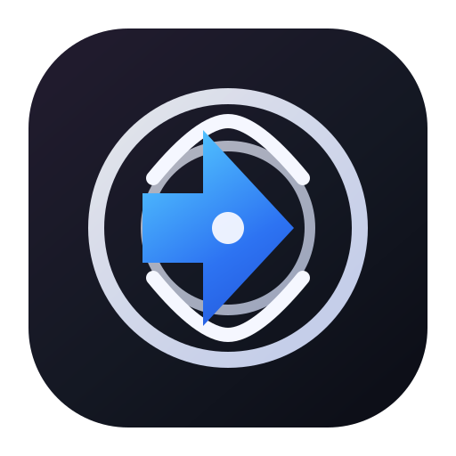

<p align="center">
  
</p>

<h1 align="center">Morrow</h1>

<p align="center">
  A focused desktop chat for your local AI.<br>
  Your conversations stay on your computer. Your model stays your choice.
</p>

<p align="center">
  
  
  
  
</p>

<p align="center">
  <a href="https://github.com/oldent0-0/morrow-local-chat/releases/download/v0.3.0/Morrow-Setup-First-Version.exe"><strong>Download for Windows</strong></a>
  ·
  <a href="https://github.com/oldent0-0/morrow-local-chat/releases">All releases</a>
</p>

## What is Morrow?

Morrow is a local-first desktop chat app for talking to a language model running on a server you choose. It brings conversations, model setup, assistant instructions, and reusable skills together in a calm, dark workspace.

There is no Morrow-hosted AI, account, or cloud sync. Morrow sends prompts to the API endpoint you configure; check that endpoint's location and privacy practices before connecting.

## Features

- **Chat that stays organized** — search conversations, create folders, and keep chat history on this computer.
- **Bring your own model** — connect to Ollama and other servers that support OpenAI-compatible Chat Completions.
- **Make it yours** — choose from eight color themes and use a workspace logo.
- **Shape your assistant** — edit [`LOCAL_MODEL.md`](LOCAL_MODEL.md) and install any of the ten built-in instruction-only skills.
- **Set it up your way** — the Windows installer lets you choose an install location and per-user or per-machine setup.

## Install

1. [Download the Windows installer](https://github.com/oldent0-0/morrow-local-chat/releases/download/v0.3.0/Morrow-Setup-First-Version.exe).
2. Run `Morrow-Setup-First-Version.exe` and follow the setup wizard.
3. Open Morrow, select **Connection**, and enter your model server's API URL and model name.

For Ollama's OpenAI-compatible API, the API base URL is usually `http://localhost:11434/v1`. Morrow sends chat requests to `<API base URL>/chat/completions`. No API key is required by Morrow itself.

## Run from source

You need Node.js and npm installed.

```powershell
npm install
npm start
```

### Tests and packaging

```powershell
npm test
npm run dist
```

`npm run dist` builds the Windows NSIS installer in `release/`. The build uses the Morrow logo for the application and installer icon.

## Customize your assistant

Morrow copies [`LOCAL_MODEL.md`](LOCAL_MODEL.md) to its app-data folder the first time you send a message or open the Skills page. The editable copy is used as the system instruction for future requests.

The Skills page includes ten built-in skills. Installed skills are saved locally and added to future requests; they are instruction-only and do not run scripts or fetch remote content. Themes, logo choice, connection settings, and chat history are also stored on this computer.

## Project layout

| Path | Purpose |
| --- | --- |
| `src/main.js` | Electron main process and local model requests |
| `src/preload.js` | Narrow, context-isolated app bridge |
| `src/renderer.js` | Chat and settings behavior |
| `src/index.html` / `src/styles.css` | App structure and visual design |
| `src/skills.js` | Bundled instruction-only skills |
| `assets/` | Morrow logo and application icons |
| `test/` | Automated tests |
| `LOCAL_MODEL.md` | Default assistant instructions |

## Privacy

Chat history and app preferences are stored in the local app profile. Prompts are sent to the model API endpoint configured in Morrow; they are not routed through a Morrow service. If you enter a remote endpoint, that server receives your prompts.

## License

No open-source license has been selected for this project. All rights are reserved; the source is available for viewing, but reuse is not granted.
